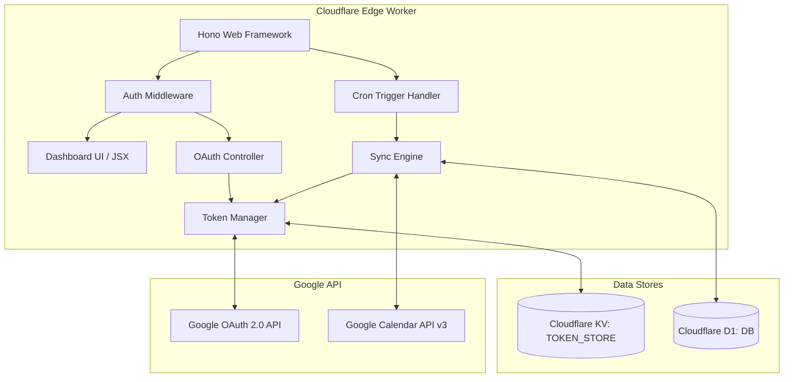

# CAL Project Implementation Plan: Calendar Replication & Anti-Double-Booking System

## Overview
This document outlines the detailed technical architecture and step-by-step implementation plan for building an open-source, edge-deployed Calendar Replication & Anti-Double-Booking System on **Cloudflare Workers** using **Hono**, **Cloudflare KV**, **Cloudflare D1**, and **Cron Triggers**, with **Google Calendar API** integration via Google SSO logins.

The project location is `/home/terry/cal`.

---

## 1. Objectives & Business Logic

### Core Goal
Prevent double-bookings across multiple Google accounts (Business, Personal, Side-Hustles) while preserving event privacy across different contexts.

### Roles & Tags (finalized)
- **`primary`** — exactly one per user. The main calendar and the Google account used to log into the dashboard.
- **`secondary`** — at least one required. Every secondary account carries exactly one required `tag`: `business`, `side_hustle`, or `personal`. The tag is a **dashboard label only** — it does not change sync behavior or replicated event titles (all secondary accounts sync identically; this preserves the privacy goal, since a tag value never leaks into what another calendar sees). "At least one secondary account must be linked" is an application-level invariant (dashboard/API should block or warn on manual sync trigger until satisfied) — it cannot be expressed as a single-row DB `CHECK` constraint.
- `business`/`other` are **no longer account roles** — superseded by the tag model above. (An earlier draft of this document used a 4-value role enum with `business`/`other` as separate roles; that draft also had an inconsistency between the role list, the DB `CHECK` constraint, and the dashboard UI spec, and was missing an `other -> primary` relay rule. This section replaces it.)

### Synchronization Rules & Topology
1. **Secondary -> Primary**: every secondary account's opaque events replicate onto Primary as **"Busy"** (`summary: "Busy"`, `transparency: "opaque"`, strip descriptions/attendees/locations).
2. **Primary -> Secondary (all)**: Primary's own opaque events replicate onto every secondary account as **"Personal Time"** (`summary: "Personal Time"`, `transparency: "opaque"`).
3. **Secondary -> Secondary (all others, excluding self)**: each secondary account's opaque events replicate onto every *other* secondary account as **"Busy"** (`summary: "Busy"`). The origin-tracking loop guard (§2) excludes only the account an event originated from, so this is safe against echo-back while still covering all N secondary accounts pairwise.
4. **Availability & Filtering Rules**:
   - Synchronize only opaque/busy events (`transparency !== 'transparent'`).
   - Preserve event types: honor all-day events (`start.date`/`end.date`) vs timed events (`start.dateTime`/`end.dateTime`) and maintain `timeZone`.
   - Real-time deletion propagation: When a source event is deleted or cancelled (`status === 'cancelled'`), its corresponding replicated event on target calendars must be deleted automatically.
   - Transparency-flip propagation: If a previously-synced event is edited from `opaque` to `transparent` (freed up, not cancelled), any existing `event_mappings` row for it is treated identically to a deletion — the downstream replica is removed, not left stale.

---

## 2. System Architecture & Tech Stack



### Storage Architecture
- **Cloudflare KV (`TOKEN_STORE`)**:
  - `tokens:{account_id}`: Store encrypted/structured OAuth access tokens, refresh tokens, and expiration timestamps.
  - `session:{session_id}`: Store session metadata for authenticated Primary user.
- **Cloudflare D1 (`DB`)**:
  - `users`: Admin user profiles (restricted to Primary SSO login).
  - `accounts`: Linked Google account metadata. `role` is `primary` (exactly one) or `secondary` (at least one); `secondary` rows additionally require `tag` (`business` / `side_hustle` / `personal`) — a dashboard label only, no effect on sync behavior.
  - `event_mappings`: Bi-directional event translation map (`source_account_id`, `source_event_id` <-> `target_account_id`, `target_event_id`).
  - `sync_tokens`: Stores Google Calendar API `syncToken` per calendar for incremental delta syncs.
  - `sync_logs`: Execution history, timestamp, status, and event counts.

### Infinite Loop Prevention Mechanism

**Design note (revised twice — see history below):**
1. *Earlier draft, 3-tier hub topology:* a blanket "skip anything tagged `syncEngine`" rule blocked legitimate two-hop relay (Business → Primary → Secondary), defeating the anti-double-booking goal for that pair. Fixed by switching to a per-target origin-comparison guard.
2. *This draft, finalized 2-role topology (§1):* the per-target origin-comparison guard from fix #1 was re-checked against the new full-mesh topology (every secondary is now always a sync source, not just Primary/Business/Other) and found to cause **duplicate delivery**: Primary's native event relays directly to SecondaryA and SecondaryB (one hop each, correct). SecondaryA is then read as a source on the next pass (secondary accounts are always sources now) — its origin-comparison guard only blocks writing back to Primary (the origin), it does *not* block relaying that same placeholder onward to SecondaryB, which already received it directly. SecondaryB ends up with two copies of the same commitment.
   **Resolution:** the 2-role topology only ever needs single-hop fan-out — every account that should see a native event receives it directly, in one hop, straight from the topology table below. There is no legitimate multi-hop relay case left to preserve, so the guard reverts to blanket-skip-of-replicas, and that is now correct (unlike in fix #1, where multi-hop relay was still required).

Every event created by this system carries custom extended metadata. The topology is single-hop only (§1: Secondary → Primary, Primary → every Secondary, Secondary → every other Secondary — never through an intermediary), so a replica is simply never eligible to be relayed further:

```json
{
  "extendedProperties": {
    "private": {
      "syncEngine": "cf-cal-replication",
      "originAccountId": "<ORIGINAL_SOURCE_ACCOUNT_ID>",
      "originEventId": "<ORIGINAL_SOURCE_EVENT_ID>",
      "syncGroupId": "<USER_ID>"
    }
  }
}
```

Rules:
- **Loop guard**: when fetching a source account's events to decide what to relay, skip any event where `extendedProperties?.private?.syncEngine === "cf-cal-replication"` — only native (human-authored) events are ever relayed. Because every target that topology requires is reached directly in one hop, this cannot under-deliver, and because a replica is never itself relayed, no chain — and no cycle — can form.
- **Origin metadata is still written and preserved**, even though it's no longer what prevents loops: `originAccountId` / `originEventId` are set once, from the native source event, when a replica is first `POST`ed, and every subsequent `PATCH` to that replica (from an edit at the origin) must re-send the same values unchanged. This is provenance for the dashboard/logs and for the deletion-cascade lookup in §5.3 step 4 (which keys off `event_mappings`, not off this metadata, but both must agree on which account/event a replica traces back to) — and it's a cheap defense-in-depth if the topology ever grows a second hop again.

---

## 3. Directory & File Structure (Target State)

```
/home/terry/cal/
├── .env.example
├── .gitignore
├── package.json
├── tsconfig.json
├── wrangler.jsonc
├── README.md
├── migrations/
│   └── 0001_initial_schema.sql
└── src/
    ├── index.ts                     # Worker entrypoint (fetch + scheduled cron)
    ├── types.ts                     # TypeScript definitions & Env interface
    ├── db/
    │   └── schema.ts                # D1 queries & helper methods
    ├── middleware/
    │   └── auth.ts                  # Session & Primary SSO auth guard
    ├── routes/
    │   ├── auth.ts                  # OAuth 2.0 PKCE login, callback, connect
    │   ├── dashboard.ts             # Hono JSX UI routes
    │   └── api.ts                   # Trigger manual sync, status endpoints
    ├── services/
    │   ├── tokenManager.ts          # KV Token storage & auto-refresh
    │   ├── syncEngine.ts            # Delta fetch, event transform, topology sync
    │   └── aiAssistantService.ts    # AI conflict resolution interface stub
    └── views/
        ├── layout.tsx               # Dashboard HTML Shell & Styling
        ├── dashboard.tsx            # Main overview & linked accounts
        ├── mappings.tsx             # Calendar roles & labels config
        └── logs.tsx                 # Sync logs & trigger button
```

---

## 4. Database Schema (D1 SQL Migration)

**Implemented and verified** in `migrations/0001_initial_schema.sql` (Phase 2, rechecked by an independent code-review pass). Beyond the original draft and the P2 #1 FK-cascade fix, the recheck found and closed:

- **A duplicate-delivery bug in the schema itself** (same class as the topology bug caught earlier in this project, just at the data layer): nothing stopped two different source events from both claiming the same `(target_account_id, target_event_id)` — if that ever happened, whichever mapping's deletion fired first would orphan the other, silently. Closed with a second `UNIQUE` index on `(target_account_id, target_event_id)`, plus `CHECK(source_account_id <> target_account_id)` to rule out self-mapping.
- **Every FK child column except `accounts.user_id` was unindexed**, meaning every cascade delete and every dashboard logs-page query was a full table scan (confirmed via `EXPLAIN QUERY PLAN`, now confirmed fixed the same way). Added indexes on `event_mappings(user_id)`, `sync_tokens(account_id)`, and `sync_logs(user_id, created_at DESC)`.
- **The same Google account could be linked twice to one user** (`accounts.email` had no uniqueness constraint) — under the full-mesh topology this means real duplicate delivery to one physical calendar. Closed with `UNIQUE(user_id, email COLLATE NOCASE)` (case-insensitive: Google account emails are effectively case-insensitive).
- **`accounts.status` had no value domain** despite being filtered on by the sync engine ("for each *active* source account," §5.3 step 2) — a typo silently drops an account from sync with no error anywhere. Added `CHECK(status IN ('active','revoked','error'))`.
- **`TEXT PRIMARY KEY` columns accepted `NULL`** (a SQLite quirk — only `INTEGER PRIMARY KEY` is implicitly `NOT NULL`) and columns with a `DEFAULT` could still be explicitly set to `NULL`. Added `NOT NULL` throughout.
- **Timestamps were space-separated (`CURRENT_TIMESTAMP`), not RFC3339**, and would collate incorrectly against Google Calendar's own RFC3339 timestamps in any future comparison. Switched to `strftime('%Y-%m-%dT%H:%M:%fZ','now')` everywhere.
- **`updated_at` only ever fired on `INSERT`**, never on `UPDATE`, despite §5.3 step 6 rewriting `sync_tokens` every cron run. Added `AFTER UPDATE` triggers on `event_mappings` and `sync_tokens` rather than relying on every future call site remembering to set it by hand.

All of the above verified with real inserts/updates against a local D1 instance, not just read for syntax — see `task_plan.md` Phase 2 entry for the specific test cases.

```sql
CREATE TABLE IF NOT EXISTS users (
    id TEXT PRIMARY KEY NOT NULL,
    email TEXT UNIQUE NOT NULL,
    created_at TEXT NOT NULL DEFAULT (strftime('%Y-%m-%dT%H:%M:%fZ', 'now'))
);

CREATE TABLE IF NOT EXISTS accounts (
    id TEXT PRIMARY KEY NOT NULL,
    user_id TEXT NOT NULL,
    email TEXT NOT NULL COLLATE NOCASE,
    role TEXT NOT NULL CHECK(role IN ('primary', 'secondary')),
    tag TEXT CHECK(tag IN ('business', 'side_hustle', 'personal')),
    status TEXT NOT NULL DEFAULT 'active' CHECK(status IN ('active', 'revoked', 'error')),
    created_at TEXT NOT NULL DEFAULT (strftime('%Y-%m-%dT%H:%M:%fZ', 'now')),
    FOREIGN KEY(user_id) REFERENCES users(id) ON DELETE CASCADE,
    CHECK(
        (role = 'primary' AND tag IS NULL) OR
        (role = 'secondary' AND tag IS NOT NULL)
    )
);
-- "At least one secondary account per user" and "exactly one primary account per user"
-- are cross-row invariants SQLite CHECK constraints cannot express — enforce at the
-- application layer (dashboard onboarding + API validation before allowing sync to run).

CREATE UNIQUE INDEX IF NOT EXISTS idx_accounts_user_email ON accounts(user_id, email);

CREATE TABLE IF NOT EXISTS sync_tokens (
    user_id TEXT NOT NULL,
    account_id TEXT NOT NULL,
    calendar_id TEXT NOT NULL DEFAULT 'primary',
    sync_token TEXT NOT NULL,
    updated_at TEXT NOT NULL DEFAULT (strftime('%Y-%m-%dT%H:%M:%fZ', 'now')),
    PRIMARY KEY (user_id, account_id, calendar_id),
    FOREIGN KEY(user_id) REFERENCES users(id) ON DELETE CASCADE,
    FOREIGN KEY(account_id) REFERENCES accounts(id) ON DELETE CASCADE
);

CREATE INDEX IF NOT EXISTS idx_sync_tokens_account ON sync_tokens(account_id);

CREATE TRIGGER IF NOT EXISTS trg_sync_tokens_touch
AFTER UPDATE ON sync_tokens
BEGIN
    UPDATE sync_tokens
    SET updated_at = strftime('%Y-%m-%dT%H:%M:%fZ', 'now')
    WHERE user_id = NEW.user_id AND account_id = NEW.account_id AND calendar_id = NEW.calendar_id;
END;

CREATE TABLE IF NOT EXISTS event_mappings (
    id TEXT PRIMARY KEY NOT NULL,
    user_id TEXT NOT NULL,
    source_account_id TEXT NOT NULL,
    source_event_id TEXT NOT NULL,
    target_account_id TEXT NOT NULL,
    target_event_id TEXT NOT NULL,
    created_at TEXT NOT NULL DEFAULT (strftime('%Y-%m-%dT%H:%M:%fZ', 'now')),
    updated_at TEXT NOT NULL DEFAULT (strftime('%Y-%m-%dT%H:%M:%fZ', 'now')),
    FOREIGN KEY(user_id) REFERENCES users(id) ON DELETE CASCADE,
    FOREIGN KEY(source_account_id) REFERENCES accounts(id) ON DELETE CASCADE,
    FOREIGN KEY(target_account_id) REFERENCES accounts(id) ON DELETE CASCADE,
    CHECK(source_account_id <> target_account_id)
);

CREATE UNIQUE INDEX IF NOT EXISTS idx_event_mappings_source_target
    ON event_mappings(source_account_id, source_event_id, target_account_id);

CREATE UNIQUE INDEX IF NOT EXISTS idx_event_mappings_target
    ON event_mappings(target_account_id, target_event_id);

CREATE INDEX IF NOT EXISTS idx_event_mappings_user ON event_mappings(user_id);

CREATE TRIGGER IF NOT EXISTS trg_event_mappings_touch
AFTER UPDATE ON event_mappings
BEGIN
    UPDATE event_mappings
    SET updated_at = strftime('%Y-%m-%dT%H:%M:%fZ', 'now')
    WHERE id = NEW.id;
END;

CREATE TABLE IF NOT EXISTS sync_logs (
    id TEXT PRIMARY KEY NOT NULL,
    user_id TEXT NOT NULL,
    status TEXT NOT NULL CHECK(status IN ('success', 'error', 'in_progress')),
    message TEXT,
    events_processed INTEGER NOT NULL DEFAULT 0,
    created_at TEXT NOT NULL DEFAULT (strftime('%Y-%m-%dT%H:%M:%fZ', 'now')),
    FOREIGN KEY(user_id) REFERENCES users(id) ON DELETE CASCADE
);

CREATE INDEX IF NOT EXISTS idx_sync_logs_user_time ON sync_logs(user_id, created_at DESC);
```

---

## 5. Detailed Component Specifications

### 5.1 Configuration & Wrangler Setup (`wrangler.jsonc`)
```json
{
  "$schema": "node_modules/wrangler/config-schema.json",
  "name": "cf-cal-replication",
  "main": "src/index.ts",
  "compatibility_date": "2026-08-04",
  "compatibility_flags": ["nodejs_compat"],
  "triggers": {
    "crons": ["*/10 * * * *"]
  },
  "kv_namespaces": [
    {
      "binding": "TOKEN_STORE",
      "id": "<YOUR_KV_NAMESPACE_ID>"
    }
  ],
  "d1_databases": [
    {
      "binding": "DB",
      "database_name": "cal-replication-db",
      "database_id": "<YOUR_D1_DATABASE_ID>"
    }
  ]
}
```

### 5.2 Token Manager (`src/services/tokenManager.ts`)
- Manages encrypted/JSON OAuth credentials in Cloudflare KV.
- Checks `expires_at` (with 2-minute buffer).
- Performs automatic POST to `https://oauth2.googleapis.com/token` with `refresh_token` when expired.
- Updates KV automatically so subsequent calls receive fresh access tokens without re-authenticating.

### 5.3 Core Sync Engine (`src/services/syncEngine.ts`)
- `runFullSync(env: Env, userId: string)`:
  1. Fetch linked accounts for user from D1 (`DB`).
  2. For each active source account:
     - Fetch incremental delta events using stored `syncToken` (or initial time-range query `timeMin = now - 7d` if no `syncToken`).
     - Handle `410 Gone` error by wiping `syncToken` and performing full re-sync.
  3. Filter events (source-level, applies once, before any target is considered):
     - Skip if `extendedProperties?.private?.syncEngine === 'cf-cal-replication'` — this event is itself a replica; only native events are ever relayed (see §2 — this is what prevents loops/duplicates under the single-hop topology).
     - If `transparency === 'transparent'`:
       - If an `event_mappings` row already exists for `(source_account_id, event.id)`, route to step 4 as a removal (transparency-flip propagation — see §1, Availability & Filtering Rules).
       - Otherwise skip (never synced, nothing to do).
  4. Process removals — triggered by either `event.status === 'cancelled'` or the transparency-flip case from step 3:
     - Look up **all** `event_mappings` rows in D1 for `(source_account_id, source_event_id)` — a native event fans out to multiple targets under the finalized topology (e.g. one secondary account's event maps to Primary *and* every other secondary account), so this is a set, not a single row.
     - For each matching row: delete the target event via Google Calendar API `DELETE /calendars/primary/events/{target_event_id}`, then remove that mapping row from D1.
  5. Process additions & updates, evaluated **per candidate target account** implied by topology (every event reaching this step is guaranteed native — step 3 already filtered out replicas):
     - Determine target accounts & labels based on role only (`tag` never affects this table):
       - Source role `secondary` -> Target: the `primary` account: summary = `"Busy"`
       - Source role `primary` -> Target: every `secondary` account: summary = `"Personal Time"`
       - Source role `secondary` -> Target: every *other* `secondary` account: summary = `"Busy"`
     - Set `originAccountId` / `originEventId` on the payload from the source account/event id (always the native event, per step 3).
     - Format target event payload with proper start/end (`date` or `dateTime`), `transparency: "opaque"`, and `extendedProperties.private` (including `originAccountId` / `originEventId`).
     - Check D1 for existing `target_event_id` for this `(source_account_id, source_event_id, target_account_id)`: if present, `PATCH` event — payload must re-send the same `originAccountId` / `originEventId` already stored; if absent, `POST` event and save new mapping to D1.
  6. Update stored `nextSyncToken` in `sync_tokens` D1 table.
  7. Log result to `sync_logs`.

### 5.4 Dashboard & Auth (`src/routes/` & `src/views/`)
- Pure Hono JSX rendering server-side HTML.
- Google SSO Login button on public route.
- Restrict dashboard access to Primary user email (`PRIMARY_ACCOUNT_EMAIL` or first registered primary account).
- Views:
  - Account Connector (`/dashboard`): Add secondary accounts via OAuth connect flow.
  - Role Mapping Configuration (`/dashboard/mappings`): Assign role (`primary`, exactly one / `secondary`, at least one) and, for each secondary account, a required `tag` (`business` / `side_hustle` / `personal`) used only as a dashboard label — event titles are not customizable per-tag (see §1 Roles & Tags: fixed generic titles preserve the privacy goal).
  - Sync History & Execution (`/dashboard/logs`): View execution history and manual trigger button (`POST /api/trigger-sync`).

### 5.5 AI Assistant Placeholder (`src/services/aiAssistantService.ts`)
- Defines standard TypeScript interfaces for future Workers AI / LLM integration:
```typescript
export interface ConflictDetectionResult {
  hasConflict: boolean;
  conflictingEvents: Array<{ accountId: string; eventId: string; summary: string }>;
  suggestedAlternativeSlots?: Array<{ start: string; end: string }>;
}

export interface AICalendarAssistantService {
  detectConflicts(userId: string, startIso: string, endIso: string): Promise<ConflictDetectionResult>;
  generateDeclineResponse(eventDetails: any): Promise<string>;
}
```

---

## 6. Security & Open-Source Compliance

1. **Zero Secrets in Repository**:
   - Local secrets placed in `.dev.vars` (included in `.gitignore`).
   - Production secrets configured via `npx wrangler secret put GOOGLE_CLIENT_ID`, `GOOGLE_CLIENT_SECRET`, `SESSION_SECRET`.
2. **Access Security**:
   - OAuth PKCE state validation.
   - HttpOnly, Secure session cookies for Dashboard auth.

---

## 7. Execution Phasing (When Approved)

- **Phase 1: Project Skeleton & Config** (`package.json`, `tsconfig.json`, `wrangler.jsonc`, `.env.example`, `.gitignore`).
- **Phase 2: Database Migration** (`migrations/0001_initial_schema.sql`).
- **Phase 3: Auth & Token Manager** (`src/types.ts`, `src/services/tokenManager.ts`, `src/routes/auth.ts`, `src/middleware/auth.ts`).
- **Phase 4: Sync Engine & Cron Handler** (`src/services/syncEngine.ts`, `src/index.ts`).
- **Phase 5: Dashboard UI & AI Service Stub** (`src/views/*`, `src/routes/dashboard.tsx`, `src/services/aiAssistantService.ts`).
- **Phase 6: Verification & Documentation** (`README.md`, build verification).

---

## 8. Verification Strategy

1. **Build Verification**:
   - Run `npm run typecheck` / `npx tsc --noEmit` to verify type safety.
   - Run `npx wrangler deploy --dry-run` to ensure Cloudflare Worker bundle builds cleanly.
2. **Local Simulation**:
   - Run `npx wrangler dev` to verify routes, auth redirects, and D1 / KV binding initializations.
